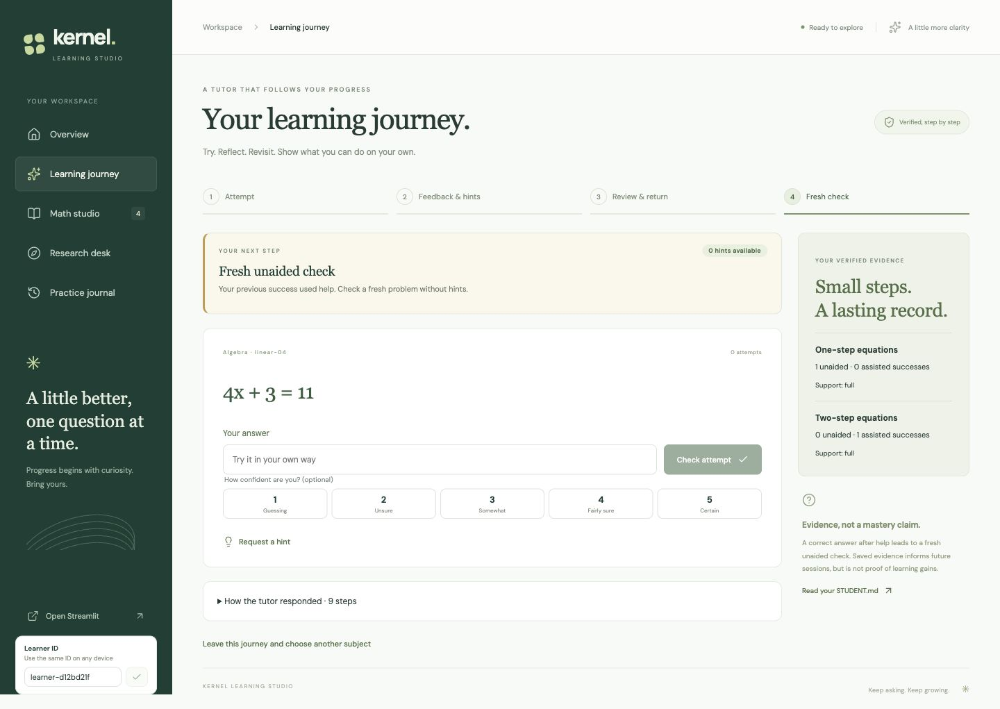

# KernelAI · React Learning Studio

A responsive React + TypeScript workspace for adaptive mathematics tutoring, verified practice, and agent research. It shares the FastAPI backend with the companion Streamlit interface.



## Start locally

Use Node 22.12+ (or Node 24/26) and the Python environment described in the root
README. From the repository root:

```sh
python3 -m venv .venv
.venv/bin/python -m pip install -r requirements.txt
npm --prefix frontend ci
./start-studio.sh
```

Open <http://127.0.0.1:5173>. The launcher starts the API on 8000 and MCP on 8001;
Ctrl+C stops only the processes it started. If those ports are occupied, set
`KERNEL_API_PORT`, `KERNEL_MCP_PORT`, and `KERNEL_UI_PORT`, or run the components
separately. To reuse an installed Python environment, set `KERNEL_PYTHON`.

Deterministic practice needs no model key. For research, create the root `.env`
from `.env.example` and set the model credentials. No secret belongs in a `VITE_`
variable, browser storage, or committed file. Restart the Python API after editing
credentials. Research uses the existing Supervisor/TaskExecutor/MCP pipeline.

For separate terminals:

```sh
# Repository root, terminal 1
.venv/bin/python -m mcp_server.server
# Repository root, terminal 2
.venv/bin/python -m uvicorn api.app:app --host 127.0.0.1 --port 8000
# Repository root, terminal 3
npm --prefix frontend run dev
```

The Vite proxy forwards `/api/*` to the Python API and strips `/api`. This keeps
development requests same-origin without broadening API CORS. To customize the
target, set `KERNEL_API_URL` in the shell or `frontend/.env`. To run Streamlit
alongside the studio, reuse the running API/MCP and start only Streamlit:

```sh
API_BASE_URL=http://127.0.0.1:8000 .venv/bin/python -m streamlit run ui/app.py
```

## Workspace features

- Learning journey: server-controlled attempts, graduated hints, reflection, prerequisite review/return, fresh unaided checks, and persistent learner evidence.
- Overview and server-backed practice catalogue; accurate browser-local counts.
- Guided algebra: original sessions, hints, revision checks, and next problems.
- Inequalities: edit linear/quadratic problems, check complete intervals, and view
  the verified number line. No solution is drawn before a correct attempt.
- Statistics: explicit data, measure and population/sample convention, chart
  preview, and independently checked answers. The first 24 values are plotted.
- Research: async submission, serialized polling, bounded backoff, pause/resume,
  reconnect on reload, task activity, Markdown/GFM tables, and raw output access.
- Journal: up to 100 browser-local checks, export, clear with undo, and access to the separate server-backed learner record.
- Responsive desktop/sidebar and mobile/drawer layouts, labelled inputs, live
  feedback, keyboard focus, and reduced-motion support.

Switching subjects aborts stale grading responses. Leaving the research page
keeps its request tracked at app level; closing the app stops browser polling but
does not cancel server work. Polling pauses after 15 minutes and can be resumed.
Neither API health nor the “ready” badge establishes model/provider availability.
Active sessions disappear on API restart; verified learner evidence in `STUDENT.md` persists and informs the next session.

## Build and validation

```sh
npm --prefix frontend run build
npm --prefix frontend test
python -m pytest -q tests/test_studio.py tests/test_algebra.py tests/test_algebra_api.py tests/test_custom_math.py
```

The build creates `frontend/dist/`. In deployment, serve these static files with
SPA fallback and reverse-proxy `/api` to the Python server. Vite's development
proxy is not part of the static build; `vite preview` alone does not provide the
API proxy. The application runs locally with pseudonymous learner IDs and no public multi-user authentication. Keep API and MCP access on trusted interfaces.

`components/` holds shared visuals; `pages/` holds screens; `hooks/` owns research
polling; `lib/` holds contracts, networking, storage and pure helpers. The backend
retains authoritative grading. Raw model content is never rendered as HTML;
reasoning/control fragments are filtered in the reading view and retained in the
explicit raw-output view. Fonts fall back to installed system fonts offline.


## Learning journey

The Learning journey view provides the connected adaptive tutoring workflow.
The server selects the teaching mode and next problem; browser controls cannot
assign correctness, enable forbidden hints, or replay solved answers. Active
sessions resume from sessionStorage IDs; verified learner evidence remains in
STUDENT.md across server restarts.

Follow [the concrete verification walk-through](../docs/interactive-tutoring-verification.md).
Math studio provides individual checks and custom
problem practice. The measured session comparison is documented separately in
`evaluation/results/journeys_20261127/report.md`.

Use `./start-all.sh` from the repository root to launch React, API, MCP and Streamlit together. Ctrl+C stops the processes started by the launcher.
