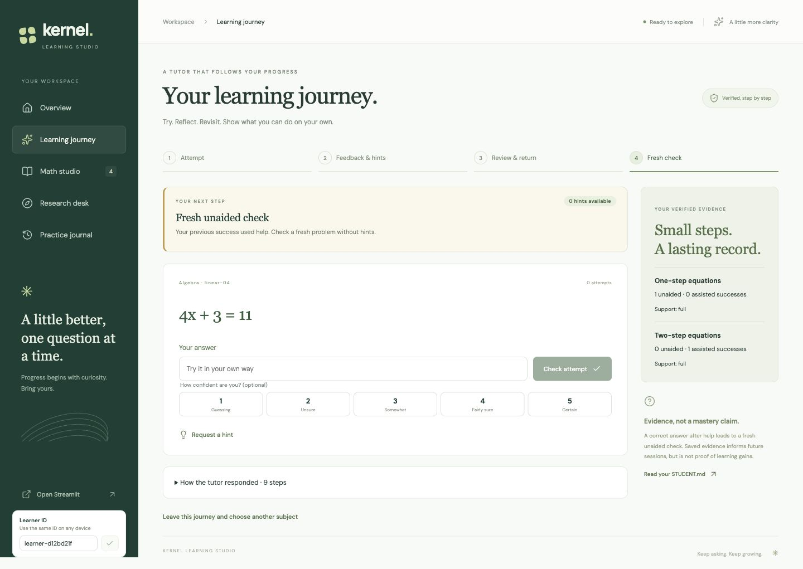
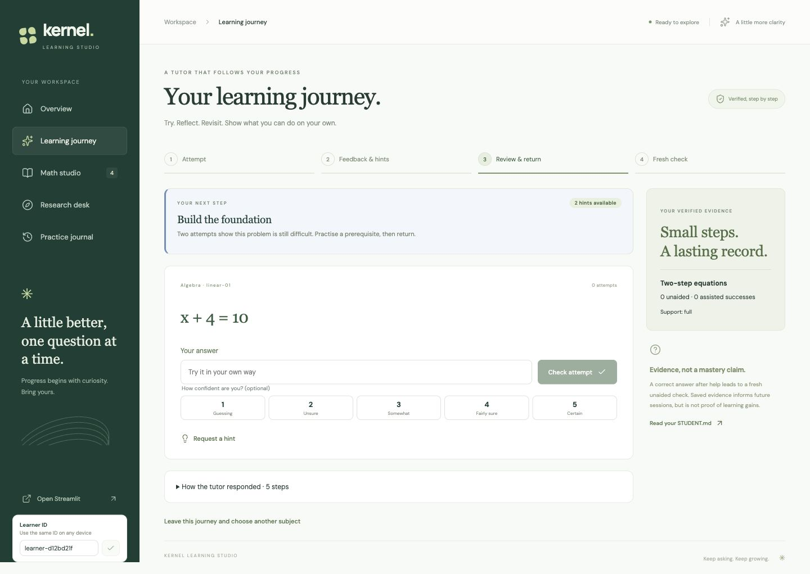
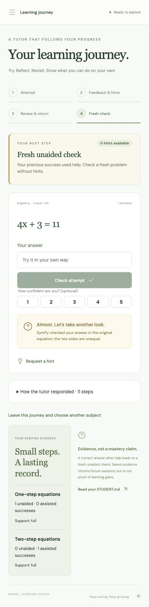

# KernelAI · Learning Studio

**An adaptive mathematics tutor with verified answers, persistent learner evidence, and an observable agent runtime.**

KernelAI guides learners through an entire practice cycle: try a problem, reflect on feedback, receive graduated help, revisit a prerequisite when needed, and demonstrate independent success on a fresh question. A React workspace brings tutoring, mathematical tools, web research, and a practice journal together. The companion Streamlit interface remains available.

[Quick start](#quick-start) · [Learning experience](#learning-experience) · [Mathematics skills](#mathematics-skills) · [Evaluation](#evaluation) · [Documentation](#documentation)



## Learning experience

The **Learning journey** is a connected, server-controlled tutoring session. The backend owns the problem, teaching mode, answer verification, and progression rules.

1. **Attempt first.** Learners try the problem before requesting help. Invalid or unsupported answers remain ungraded.
2. **Reflect and receive help.** Conceptual, strategic, and procedural hints provide increasing support. Deeper hints require a short reflection.
3. **Review and return.** Repeated difficulty triggers prerequisite practice, followed by a return to the original problem.
4. **Check independence.** An assisted success leads to a different problem with hints disabled. Solved items cannot be replayed as fresh evidence.
5. **Adapt future practice.** Verified attempts and hints inform support fading, returning-learner recall, and subsequent sessions.

Learner evidence is saved in a server-side `STUDENT.md` record. Session revisions protect against duplicate or stale actions, and page reloads restore the active journey. Learner records survive server restarts; active sessions are transient and expire after one idle hour. The finite problem bank reports exhaustion rather than silently reusing a solved item as new assessment evidence.

### Prerequisite review

The tutor moves from difficulty to a simpler prerequisite, then returns the learner to the original task.



### Workspace

| Area | What it provides |
|---|---|
| **Learning journey** | Adaptive practice across algebra, inequalities, statistics, geometry, and linear systems. |
| **Math studio** | Individual answer checks, guided algebra, custom symbolic problems, and subject-specific practice. |
| **Research desk** | Web research through the Supervisor, task workers, and MCP tools, with task activity and reconnectable request tracking. |
| **Practice journal** | Browser-local check history, export, and a view of the server-backed learner record. |
| **Probability Lab** | Coin and dice experiments, theoretical distributions, simulation results, and convergence charts in Streamlit. |
| **Observability** | Request, task, worker, and tool events, execution traces, and runtime status. |
| **Offline learning** | Trace evaluation, policy inspection, and candidate generation with explicit manual release. |

<details>
<summary>View the mobile learning journey</summary>



</details>

## Mathematics skills

Deterministic tools check mathematical answers independently of model-generated prose. Supported capabilities include:

| Subject | Capabilities |
|---|---|
| **Algebra** | Linear and quadratic equations, simplification, factoring, expansion, and polynomial derivatives. |
| **Inequalities** | Real constant, linear, and quadratic inequalities with complete interval-set checking. |
| **Statistics** | Descriptive measures with explicit population/sample conventions, including variance and standard deviation. |
| **Geometry** | Area, perimeter, circles, Pythagorean theorem, triangle angles, and coordinate geometry. |
| **Linear systems** | Two-variable systems, exact answer checking, hints, and worked elimination steps. |
| **Probability** | Interactive coin and dice simulations and comparison with theoretical distributions. |

Custom LLM-assisted algebra includes interpretation review before verification. The mathematical checker verifies the reviewed expression or equation; model explanations and word-problem translations are not automatically certified. Probability simulations are separate from the scored tutoring journeys.

### Linked skills vault

Open [`vault/`](vault/) with **Obsidian → Open folder as vault**, then follow [`skills/REGISTRY.md`](vault/skills/REGISTRY.md) → [**mathematics**](vault/skills/math/DOMAIN.md). Use **Graph view** (`Cmd+G` on macOS) to explore the links.

The mathematics domain connects 12 operational notes covering subject practice, symbolic operations, solution checking, and interactive tutoring. Teaching links connect attempt-first retrieval, progressive hints, prerequisite review, support fading, and unaided evidence. Runtime-delegatable skills are explicitly registered in [`skills/registry.py`](skills/registry.py); canonical mathematics prompts live in [`vault/skills/math/`](vault/skills/math/).

## Quick start

### Prerequisites

- **Python 3.11–3.14** with `venv` and `pip`.
- **Node.js 22.12+** and npm, using a version supported by Vite 8.
- Git, Bash, and macOS, Linux, or WSL.
- An OpenAI-compatible endpoint and model credentials for research and LLM-assisted custom questions. Deterministic tutoring and its session evaluation need no model key.

### Install

```bash
git clone https://github.com/samarthsubramanya/AdaptiveTutoring-AgenticAI-Fall26.git
cd AdaptiveTutoring-AgenticAI-Fall26
git switch samarth/learning-studio
python3 -m venv .venv
source .venv/bin/activate
python -m pip install -r requirements.txt
npm --prefix frontend ci
cp .env.example .env
```

For research and model-assisted features, edit the root `.env`:

```dotenv
ASU_LLM_API_KEY=your-api-key
ASU_LLM_BASE_URL=https://openai.rc.asu.edu/v1
ASU_LLM_MODEL=your-tool-capable-model
MCP_SERVER_URL=http://127.0.0.1:8001/mcp
KERNELAI_AGENT=generic
SHELL_WORKSPACE=/absolute/path/to/an/existing/workspace
```

Use your provider's endpoint and an available model. Keep credentials server-side in the ignored `.env` file; never place them in `VITE_` variables. Restart the Python services after changing configuration.

### Launch

```bash
./start-all.sh
```

The launcher starts React, FastAPI, MCP, and Streamlit. Keep the terminal open; **Ctrl+C** stops the processes it started.

| Service | Address |
|---|---|
| **React Learning Studio** | [127.0.0.1:5173](http://127.0.0.1:5173) |
| **Learning journey** | [127.0.0.1:5173/#/journey](http://127.0.0.1:5173/#/journey) |
| **API documentation** | [127.0.0.1:8000/docs](http://127.0.0.1:8000/docs) |
| **Streamlit** | [127.0.0.1:8501](http://127.0.0.1:8501) |
| **MCP tools** | `http://127.0.0.1:8001/mcp` — protocol endpoint |

Use `./start-studio.sh` for React, API, and MCP only. Use `bash start.sh` for the Streamlit-based stack. Run one launcher at a time with the default ports. Port overrides are `KERNEL_API_PORT`, `KERNEL_MCP_PORT`, `KERNEL_UI_PORT`, and, with `start-all.sh`, `KERNEL_STREAMLIT_PORT`. Set `KERNEL_PYTHON` to use an existing Python environment.

### Try a complete tutoring session

1. Open **Learning journey** and switch to a fresh learner ID in the sidebar.
2. Select **Statistics → Spread (variance, standard deviation)** and begin. The first problem asks for the population variance of `1, 3, 5`.
3. Submit `0`, request a hint, and reflect before requesting deeper help.
4. Submit `0` again and select **Review prerequisite**. Answer the mean question with `3`.
5. Continue back to the original problem and answer `8/3`.
6. Continue to a fresh unaided check. Reload the page to verify session recovery, and open **Read your STUDENT.md** to inspect saved evidence.

See the [verification guide](docs/interactive-tutoring-verification.md) for the full walkthrough, including hint gating and support fading.

## Architecture

```text
React Learning Studio / Streamlit
              │
           FastAPI
              ├── Journey engine ── Mathematical verification
              │         └────────── Learner evidence (STUDENT.md)
              │
              └── Orchestrator → Supervisor → Task workers → MCP tools
                                      │                      │
                                  Skill registry ←── Linked skills vault
                                      │
                              Events and execution traces
                                      │
                              Offline policy evaluation
```

Journey tools exposed over MCP call the same authoritative HTTP session engine used by the frontend. The runtime schedules concurrent requests and tasks, while structured events expose their lifecycle. Offline evaluation produces policy candidates; releasing a candidate is a separate manual operation.

## Evaluation

The full-session evaluation exercises the production HTTP router and journey engine through an in-process ASGI transport, with isolated disk-backed learner records. Two fixed synthetic datasets—**algebra sessions** and **statistics sessions**—each contain six scenarios: assisted recovery, prerequisite return, hint reflection, independent fading, resumption after assistance, and invalid/stale actions.

Three policies produce **36 trials**: the adaptive tutor with memory, a fixed-sequence policy without memory, and an adaptive policy without cross-session memory. All trials completed without scenario errors.

| Metric, per dataset | Adaptive + memory | Fixed, no memory | Adaptive, no memory |
|---|---|---|---|
| Completed scenarios | 6/6 | 6/6 | 6/6 |
| Prerequisite review and return | 1/1 | 0/1 | 1/1 |
| Fresh unaided check | 4/4 | 0/4 | 3/4 |
| Return-session recall | 4/4 | 0/4 | 0/4 |
| Memory retained | 4/4 | 0/4 | 0/4 |

These are **workflow and persistence results from scripted synthetic sessions**. The controls are policy ablations, not the earlier B1/B2 model baselines. The evaluation does not measure human learning gains or LLM explanation quality. Applicable denominators, source hashes, and HTTP traces accompany the [results report](evaluation/results/journeys_20261127/report.md).

Reproduce the session evaluation:

```bash
.venv/bin/python -m evaluation.journeys.run --output evaluation/results/local_journeys
```

### Automated verification

The November 27 verification passed **201 selected Python tests**, **three frontend tests**, the production build, and formatting checks. Coverage includes HTTP journey scenarios, prerequisite return, revision protection, learner persistence, mathematical checkers, vault links, observability, and MCP session routing.

```bash
source .venv/bin/activate
python -m pytest -q tests/test_journey_tools.py tests/test_journeys.py tests/test_journey_evaluation.py tests/test_vault_math.py tests/test_learners.py tests/test_algebra.py tests/test_algebra_api.py tests/test_custom_math.py tests/test_geometry.py tests/test_studio.py tests/test_observability.py tests/test_tool_observability.py
npm --prefix frontend test
npm --prefix frontend run build
npm --prefix frontend run format:check
```

The selected tests use local fixtures or mocked external calls. Other integration tests can require live services, model credentials, and externally provisioned data. API health confirms service availability; it does not validate external provider credentials.

## Project structure

| Path | Responsibility |
|---|---|
| [`frontend/`](frontend/) | React and TypeScript workspace, responsive UI, request tracking, and journal. |
| [`tutoring/`](tutoring/) | Adaptive journey engine, learner evidence, mathematical checkers, and tutoring routes. |
| [`api/`](api/) | FastAPI application and request/session endpoints. |
| `orchestrator/`, `supervisor/`, `tasks/`, `worker/` | Request admission, delegation, and concurrent agent execution. |
| [`mcp_server/`](mcp_server/) | Discoverable tools, including authoritative journey API clients. |
| [`skills/`](skills/), [`vault/`](vault/) | Runtime skill registration and linked mathematics/teaching notes. |
| [`observability/`](observability/) | Runtime events, sanitization, traces, and lifecycle projections. |
| [`learning/`](learning/) | Persistent learner records, trace evaluation, policy candidates, and releases. |
| [`evaluation/journeys/`](evaluation/journeys/) | Fixed datasets and the full-session comparison runner. |
| [`ui/`](ui/) | Companion Streamlit interface and dashboards. |
| [`tests/`](tests/), [`docs/`](docs/) | Automated checks, setup guides, screenshots, and feature documentation. |

## Documentation

- [Interactive tutoring verification](docs/interactive-tutoring-verification.md)
- [React setup and deployment](frontend/README.md)
- [Full-session evaluation results](evaluation/results/journeys_20261127/report.md)
- [Mathematics skills vault](vault/skills/math/DOMAIN.md)
- [Probability Lab](docs/probability-lab.md)
- [Linear-system practice](docs/math-linear-systems.md)

## Operating notes

KernelAI runs locally with pseudonymous learner IDs and does not provide public multi-user authentication. Learner records are stored under `learning/data/students/` and are git-ignored; set `KERNELAI_STUDENT_DIR` to change that location. The browser-local journal is separate from server-side learner evidence.

For port conflicts, stop the conflicting service or use the launcher overrides. If dependencies are missing, activate `.venv`, reinstall `requirements.txt`, and run `python -m pip check`. If research fails, verify the three `ASU_LLM_*` settings and the availability of the configured model, then restart the Python services.
